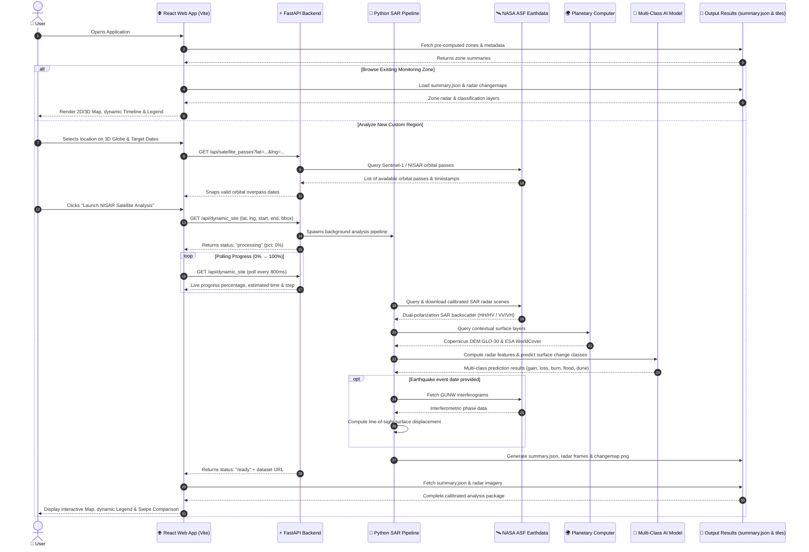

# 🛰️ SARdance (NovaCode-SAR)
### Multi-Temporal SAR Radar Earth Surface Change Detection & AI Soil Classification

[](https://www.spaceappschallenge.org/)
[](https://react.dev/)
[](https://vitejs.dev/)
[](https://fastapi.tiangolo.com/)
[](https://www.python.org/)
[](https://leafletjs.com/)
[](https://tailwindcss.com/)

Built for the **NASA Space Apps Challenge 2026**, challenge **"Dancing with the SARs"**.

**SARdance** is an end-to-end Earth observation web platform that ingests, calibrates, and classifies spaceborne Synthetic Aperture Radar (**SAR**) imagery from **NASA ASF** (Sentinel-1 C-Band and NISAR L-Band). Radar microwaves penetrate clouds, dust storms, wildfire smoke, and nocturnal darkness to track and quantify physical surface changes anywhere on the globe in real time.

---

## 🌟 Key Features

* **🌍 Photorealistic 3D Galaxy Globe:** Interactive Three.js/WebGL globe with dynamic geocoding search (`Algiers`, `Paris`, `Tokyo`), territory boundaries, country detection, and smooth fly-to camera animations.
* **🛰️ Real-Time NASA Datapool Ingestion:** Direct connection to the NASA Alaska Satellite Facility (ASF) API to discover, download, orthorectify, and analyze actual satellite radar overpasses.
* **🧠 Multi-Class AI Soil & Terrain Classifier:** Bi-temporal change detection combined with polarimetric backscatter analysis ($\sigma^0_{\text{HH}}, \sigma^0_{\text{HV}}, \text{and } \sigma^0_{\text{VV}}, \sigma^0_{\text{VH}}$) and spatial speckle filtering:
  * 🌱 **Vegetation Growth** (Active canopy expansion)
  * 🍂 **Vegetation Loss** (Harvesting, defoliation, clear-cutting)
  * 🔥 **Burned Area** (Wildfire burn scars)
  * 🌊 **Inundation / Flooding** (Specular water expansion)
  * 💧 **Permanent Water Bodies** (Baseline reservoirs, lakes, rivers)
  * 🏜️ **Soil & Dune Dynamics** (Arid terrain wind dynamics, sand displacement)
  * 🏢 **Stable Terrain & Built-up**
* **↔️ Interactive Swipe Compare Mode:** Draggable dual-pane slider comparing initial raw radar passes with subsequent passes augmented with AI change masks.
* **📊 Dynamic Timeline & Legend:** Real-time surface area calculation (hectares / $\text{km}^2$) that recalculates dynamically as you navigate temporal radar acquisitions.
* **⏱️ Transparent 0% to 100% Processing:** Real-time feedback showing downloading, orthorectification, calibration, and AI prediction progress with live remaining time estimation.

---

## 🔄 System Architecture & Sequence Diagram

The following sequence diagram illustrates the communication flow across the **React Frontend**, **FastAPI Backend**, **Python Pipeline**, **NASA ASF Earthdata**, and the **AI Classification Engine**:



---

## 🛠️ Tech Stack

### Frontend
* **Core:** [React 19](https://react.dev/), [Vite](https://vitejs.dev/)
* **Mapping:** [Leaflet](https://leafletjs.com/), [React-Leaflet](https://react-leaflet.js.org/)
* **3D Visualization:** [Three.js](https://threejs.org/), [Three-Globe](https://github.com/vasturiano/three-globe)
* **Styling & Fonts:** [TailwindCSS 4](https://tailwindcss.com/), [Google Fonts (*Outfit*, *Space Grotesk*, *JetBrains Mono*)](https://fonts.google.com/)
* **Icons:** [Google Material Symbols](https://fonts.google.com/icons)

### Backend & API
* **Web Framework:** [FastAPI](https://fastapi.tiangolo.com/), [Uvicorn](https://www.uvicorn.org/)
* **Data Retrieval:** NASA Alaska Satellite Facility API (`asf_search`), NASA Earthdata Login (`urs.earthdata.nasa.gov`)
* **GIS & Image Processing:** [Pillow (PIL)](https://python-pillow.org/), [NumPy](https://numpy.org/), [SciPy](https://scipy.org/)
* **Contextual Data:** Microsoft Planetary Computer STAC API (Copernicus DEM GLO-30, ESA WorldCover)

---

## 🚀 Getting Started Locally

### Prerequisites
* **Node.js**: v18.0.0 or later
* **Python**: v3.10 or later
* **NASA Earthdata Account**: Free registration at [urs.earthdata.nasa.gov](https://urs.earthdata.nasa.gov/) (optional for downloading new raw orbits; default demo sites work out of the box).

---

### 1. Clone the Repository
```bash
git clone https://github.com/souhaibha/NovaCode-SAR.git
cd NovaCode-SAR
```

---

### 2. Backend Setup (FastAPI & Pipeline)

1. **Create and activate a virtual environment:**
   ```bash
   # On macOS / Linux
   python3 -m venv venv
   source venv/bin/activate

   # On Windows (PowerShell)
   python -m venv venv
   .\venv\Scripts\Activate.ps1
   ```

2. **Install Python dependencies:**
   ```bash
   pip install -r requirements.txt
   ```

3. **Start the FastAPI backend server:**
   ```bash
   python -m uvicorn pipeline.backend:app --host 0.0.0.0 --port 8000
   ```
   *The backend will be live at `http://localhost:8000`.*

---

### 3. Frontend Setup (React + Vite)

1. **Navigate to the `app` directory and install dependencies:**
   ```bash
   cd app
   npm install
   ```

2. **Start the local development server:**
   ```bash
   npm run dev
   ```
   *The application will open at `http://localhost:5173`.*

3. **Build for production:**
   ```bash
   npm run build
   ```

---

## 📡 API Reference

| Endpoint | Method | Description |
|---|---|---|
| `GET /api/satellite_passes?lat={lat}&lng={lng}` | `GET` | Returns authentic Sentinel-1 / NISAR overpass dates for any geographic coordinate. |
| `GET /api/dynamic_site?lat={lat}&lng={lng}&start={d1}&end={d2}` | `GET` | Fetches, calibrates, and classifies radar data for any custom area on demand. |
| `POST /api/coverage` | `POST` | Validates dual-polarization NISAR/Sentinel-1 track availability for an explicit bounding box. |
| `POST /api/jobs` | `POST` | Submits an offline batch radar pipeline job. |
| `GET /api/jobs/{id}` | `GET` | Retrieves real-time status and execution progress of a running job. |

---

## 📊 AI Model & Radar Polarimetry

SAR microwave backscatter responds to physical surface roughness, dielectric permittivity, and moisture:

$$\gamma^0 = \frac{\sigma^0}{\cos \theta_i}$$

* **Volume Scattering ($\text{HV} / \text{VH}$):** Interacts with vegetation canopies and biomass.
* **Surface Scattering ($\text{HH} / \text{VV}$):** Interacts with rough soil, plowed land, and burn scars.
* **Specular Reflection ($\text{Low Backscatter}$):** Smooth open water surfaces reflect microwave pulses away from the antenna, creating low returns (<-20 dB).
* **Speckle Mitigation:** A spatial median filter removes high-frequency speckle noise before computing bi-temporal ratios ($\Delta\text{dB}$).

---

## 👥 Authors & Acknowledgments

* **Challenge:** NASA Space Apps Challenge 2026 (*Dancing with the SARs*)
* **Satellite Data:** NASA / JPL-Caltech / ISRO NISAR Mission & ESA Copernicus Sentinel-1 via Alaska Satellite Facility (ASF).
* **Reference Labels:** Copernicus Sentinel-2, ESA WorldCover 2021, and USGS Earthquake Hazards Program.

---

## 📄 License
This project is licensed under the [MIT License](LICENSE).
